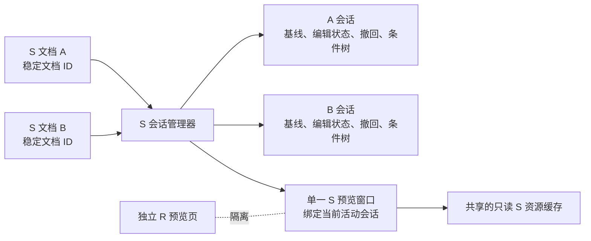

# S 战场多剧本文档独立预览会话

## 状态

方案已获批准，规格待用户审阅。当前阶段只定义行为和验收条件，不包含实现改动。

## 目标

同时打开多份 S 剧本时，每份剧本都拥有独立的战场预览、临时布置、写回撤回记录和条件树状态。切换文档后，预览绑定到目标文档已有的会话；未变化的文档无需重新捕获、解析或解码资源。关闭一份剧本只释放该剧本的会话。

快速模式对新打开的 S 剧本仍默认为开启，并以 Scene1 战场 Section 为固定来源。R 预览保持独立，切换 R/S 页面不得清除仍打开的 S 文档会话。

## 当前代码证据

- `cczEditor2/ScenePreviewHost.h` 中宿主只持有一个 `CSBattlePreviewPage m_sPage`。
- `cczEditor2/BattlePreviewPage.h` 中基线捕获、原生写回事务、编辑状态和活动条件工作区均属于这一个 S 页面；条件工作区按逻辑节点区分，没有文档维度。
- `CcczEditor2View::OnActivateView` 会刷新预览。快速模式对同一来源调用 `CaptureEditorPinnedSectionSnapshot` 并重新计算 Section revision；更换文档时会捕获完整文档，再清理并重建页面状态。
- `CChildFrame::OnClose`、`CcczEditor2Doc::SaveModified`、`OnCloseDocument`、View 的 `OnDestroy` 和 `CMainFrame::OnAllFileClose` 分别参与关闭和树销毁流程。现有预览关闭检查以当前绑定的树句柄为中心，不能代表所有已打开 S 文档的会话；批量关闭入口还会在调用 `SaveModified` 后根据 `can_close` 再次自行判断是否关闭。

因此，文档切换重复执行快照工作，以及单页只能保存一份可变状态，都是由现有结构直接造成的。实际耗时仍须在实现阶段测量，当前没有毫秒级基准。

## 范围

### 本次包含

- S 预览会话按打开的 MFC 文档实例隔离。
- 快速模式、Scene1 基线、战场编辑状态、条件树工作区、撤回记录和必要的界面状态按文档恢复。
- 文档内容版本与树生命周期版本用于切换快速路径和旧句柄失效判断。
- S 只读资源跨文档复用，并采用有界的图像解码缓存。
- 文档关闭、树重建、应用退出分别执行正确的会话解绑或清理。
- 加入可核验的捕获、解析、解码次数与切换耗时数据。

### 本次不包含

- 修改 R 预览模型、缓存、坐标或撤回逻辑。
- 将 S 的预览状态或写回事务迁入 R 页面。
- 把预览临时布置持久化到独立文件或跨应用重启恢复。
- 改变 S 写回的数据格式、Reachability 语义或现有 QA 写回权限。
- 为非快速模式增加跨 Section 的多个独立战场编辑缓存；非快速模式继续遵循现有 Section 切换规则。

## 架构

### 文档身份

- 每个 `CcczEditor2Doc` 实例创建时取得一个进程内唯一、单调递增的 `SPreviewDocumentId`。
- 会话注册表以该 ID 为键。文件路径用于验证来源和定位资源，不作为会话主键；`HWND` 和 `HTREEITEM` 也不作为会话身份。
- ID 不写入 EEX，也不跨应用启动复用。应用进程退出时，所有仅存在于内存的会话自然销毁。

### 会话所有权

`CScenePreviewWnd` 负责 S 会话注册表与当前活动 ID；`CSBattlePreviewPage` 继续作为唯一的 S 窗口和交互呈现层。每份 `BattlePreviewDocumentSession` 至少拥有：

- 文档 ID、规范化路径、最近观察到的文档内容版本和树生命周期版本。
- Scene1 基线捕获、Scene1 Section revision、快速模式状态及来源诊断。
- `BattleEditorState`、对应的 `BattleEditorOps`、原生写回事务/撤回栈。
- 条件树可达工作区、活动逻辑节点、回放选项、目录和模型引用。
- 需跨文档切换恢复的界面值：缩放、滚动位置、活动页签、搜索内容、角色/小兵选择、部署指令和方向。

拖拽、框选、悬停格、鼠标按下状态等瞬时交互不跨文档恢复。`BattleEditorOps` 只引用会话自己持有的稳定 `BattleEditorState`；预览页在绑定时将活动会话的操作对象映射到现有 UI 控件。

会话不持有长期有效的 `CTreeCtrl*`、`CView*`、窗口对象或 Native Host 指针。为来源定位和原生撤回，会话可以保存带 `tree_generation` 的不透明节点句柄；只有当前绑定树的版本完全匹配时才可使用。原生写回/撤回调用时，使用当前绑定文档和树创建临时 Native Host。版本不匹配时，任何旧句柄操作都必须拒绝。

### 文档切换

1. 记录当前预览控件的可恢复界面值，将当前会话标记为 parked，并解除页面对其 TreeView 的临时绑定。
2. 按目标文档 ID 查找或建立会话。首次打开的 S 文档只在此时捕获并解析一次；新会话快速模式默认为开启。
3. 对已有会话执行下文的版本检查。来源有效时，把页面绑定到该会话并恢复 UI；不重新建立编辑状态或撤回栈。
4. 切换到 R 或未知前缀时，隐藏 S 页面并 parked 当前 S 会话。不得调用 `ClearDocument` 清空该 S 文档的会话，也不得因离开 S 页面询问是否放弃临时布置。

选择 Section 与激活文档分开处理。快速模式下，Section 选择变化不会改变固定 Scene1 来源，也不清除该文档的 Scene1 状态。非快速模式仍使用现有 Section 行为。

## 版本检查与陈旧会话

文档提供单调递增的 `content_epoch`；文档树被整体重建或替换时，另增 `tree_generation`。会话记录上次成功绑定时的两个值。

- 选择、滚动、展开/折叠、绘制等导航或视图变化不增加 `content_epoch`。
- 所有改变 TreeView 指令或其 `ItemData` 语义内容的操作都必须增加 `content_epoch`，包括编辑器命令、批处理、原生 S 写回/撤回和其他直接修改数据结构的入口。
- 加载新树时不对每个节点重复递增；在重建开始前使旧树绑定失效，并在新树完成后增加 `tree_generation` 与 `content_epoch`。
- 在增加版本前，实施必须逐一审计直接改写 `ItemData` 和直接调用 TreeView 修改接口的路径。遗漏路径不得通过“版本未变”快路径被当作已验证。

切换时按以下规则处理：

| 版本状态 | 行为 |
|---|---|
| `content_epoch` 与 `tree_generation` 均未变化 | O(1) 绑定会话，不捕获剧本、不重建战场。 |
| 内容版本变化、树未整体替换 | 只捕获固定 Scene1 Section 并比较内容 revision。Section 未变则保留会话并更新观察版本；Section 已变则进入陈旧状态。 |
| 树生命周期版本变化 | 立即使所有旧树句柄及依赖它们的原生撤回操作失效；重新捕获当前文档来源。 |

如果 Scene1 改变且会话没有未写回的临时预览修改，可直接按现有快速模式规则重载 Scene1。若存在临时修改，则保留当前预览和草稿，标记来源陈旧，并禁用写回，直到用户明确刷新/丢弃草稿。单纯切换文档时不弹出阻塞式确认。

所有实际写回仍须使用当前树重新捕获来源，并验证文档 ID、树版本、Section 内容、逻辑来源与插入锚点。`content_epoch` 只是省略无变化切换扫描的快速门；它不能代替写回前的完整校验。

`BattleWritebackNativeTransaction` 当前以整份文档 revision 检查撤回条件。会话隔离后每份文档持有自己的事务；本次保留该保守撤回校验，不扩大为跨无关 Section 的撤回语义调整。

## 资源缓存与内存

- 每文档保存的是预览状态和资源引用，不复制整套只读游戏数据。
- `BattleAssetCache` 等只读资源继续按规范化 MOD 根目录和资源 revision 共享。
- 地图 JPG、单位精灵的已解码位图跨 S 文档按规范化文件路径和文件 revision 复用；缓存使用 LRU 或等效的有界淘汰策略，只淘汰当前没有活动引用的资源。容量上限在实测峰值内存后确定，并可在文档关闭后释放无引用条目。
- 不缓存 R 专属资源，不改动 R 的资源所有权。

## 文档关闭与树生命周期

必须拆分当前容易混淆的生命周期入口：

- `Detach/Rebuild`：树窗口被重建或暂时销毁时，只解除树句柄绑定并增加树版本；文档仍然存在时保留预览会话。
- `CloseDocument`：真正关闭某个 `CcczEditor2Doc` 时，只移除其文档 ID 对应的会话。其他 S 文档和活动预览状态保持不变。
- `ApplicationExit`：在文档关闭决策完成后，释放所有剩余会话和共享缓存。

重复到达的 View `OnDestroy`、Doc `OnCloseDocument` 或重建通知必须幂等，不能二次释放资源或误删其他 ID 的会话。

关闭决策遵循两类不同状态：

- 尚未写回的预览草稿只存在于内存会话中；关闭对应 S 文档会丢失草稿，必须让用户明确选择保留文档打开或放弃该草稿。
- 已通过 QA 写回的内容已修改当前文档内存树，由常规文档修改/保存流程负责。会话撤回栈随文档关闭销毁，不应把已写回内容误报为尚未写回的草稿。

子窗口关闭、主窗口退出、批量关闭和 MFC 文档关闭必须共用一个按文档 ID 工作的关闭协调器。协调器分别处理预览草稿确认和常规剧本文档保存；同一关闭尝试中每类待处理状态只询问一次。取消任一阶段都必须保留文档与会话。批量关闭必须尊重 `SaveModified` 的返回结果，不能因过期的 `can_close` 状态而越过取消决定。只有在文档确定关闭后才能从会话注册表移除该会话。

## 性能观测

Debug/QA 观测至少记录每次文档激活的：目标文档 ID、会话命中/新建、`CaptureEditorDocumentSnapshot` 次数、Scene1 Section 捕获次数、Battle 输入构建次数、地图/精灵解码次数及总耗时。不得把诊断计数用于改变写回行为。

验收时先记录当前构建在相同数据、相同机器上的交替切换基准，再使用同样步骤测新构建。至少覆盖冷首次打开、热切换 A/B、S/R/S 往返和资源缓存淘汰；报告中列出操作次数、切换中位耗时、P95 和内存峰值。未测得的数据不声明为性能改善。

## 验收

1. 两份 S 文档 A/B 各自首次打开 Scene1；分别调整位置、使用新增单位笔刷、执行多次写回和撤回，所有操作只影响当前文档。
2. A→B→A 往返后，未写回草稿、BattleEditorState、活动条件树工作区、Scene1 基线、快速模式勾选状态和撤回能力均属于原会话并正确恢复。
3. 对未变化的已打开 S 文档，切回时不调用完整文档捕获、不构造新 Battle 输入、不重放完整预览、不重复解码已缓存资源。
4. 内容 epoch 变化但 Scene1 内容相同，保留会话；Scene1 内容变化时准确标记陈旧、保留草稿并阻止写回，用户刷新后才能继续。
5. 树被重建后，旧节点句柄和旧撤回记录不会被用于新树；重新绑定/刷新成功后才允许新的原生操作。
6. 从 S 切到 R 再返回，S 会话不清除，R 预览状态与资源不受影响。
7. 关闭 B 只释放 B；A 的草稿仍在且可恢复。子窗口关闭、批量关闭和应用退出时取消预览草稿确认或常规保存，都必须使对应文档和会话保持打开；批量关闭不能用过期的关闭标记绕过取消。应用退出后没有磁盘残留的预览草稿缓存。
8. 同一路径的两个不同文档实例不会因为路径相同而共用可变会话；任何写回都校验当前实际文档实例。
9. 现有快速模式、条件树、角色/小兵笔刷、S 写回、撤回和 R 预览合同测试继续通过；完成 Win32 Debug QA 与 Release 构建。
10. 真实 MFC 窗口执行至少 A/B 两份 S 剧本与 R 往返、写回/撤回、树重建、关闭/退出流程，并与性能基准一同记录。自动化通过不替代实机验收。

## 自审

- 文档路径和窗口句柄不会导致两份打开文档共用可变状态；会话 ID 由文档实例拥有。
- 文档关闭与 TreeView 重建是不同操作；销毁树不会误删仍打开文档的临时预览状态。
- 版本计数只提供切换快路径，写回前仍有当前树的完整来源校验，因此版本漏记不会成为静默写错的许可条件；漏记仍须通过入口审计和测试消除。
- 共享缓存只含可重建的只读资源，S 编辑状态和撤回事务不会放进共享缓存，R 状态也不会混入。
- 规格没有承诺未经测量的毫秒目标；实际耗时、缓存峰值和淘汰上限须在实现验证中给出证据。
- 未覆盖跨进程外部改写磁盘文件的实时检测。编辑器以内存中的当前文档树为来源；外部文件变化只有在文档显式重载后才进入会话版本检查。
